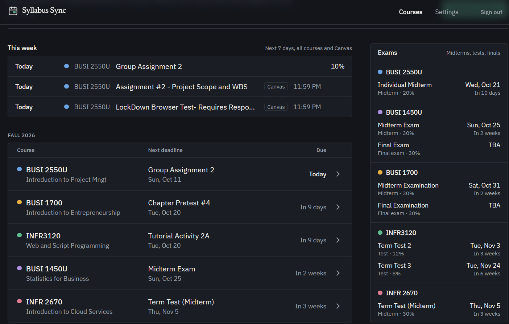
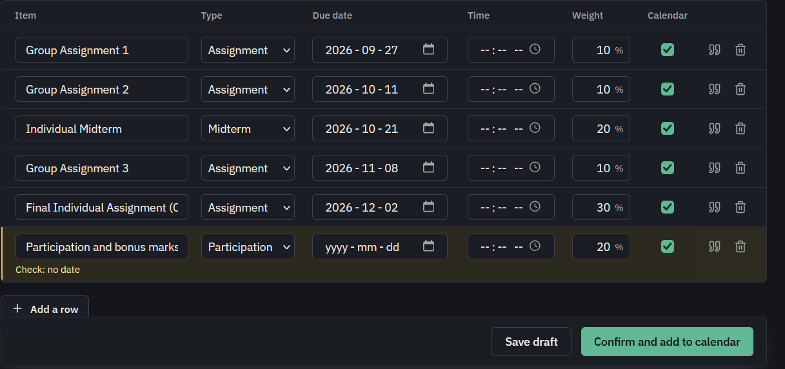
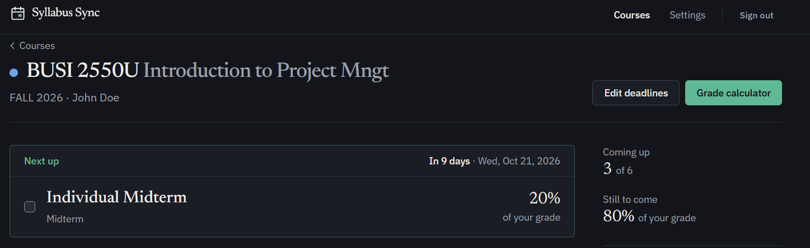
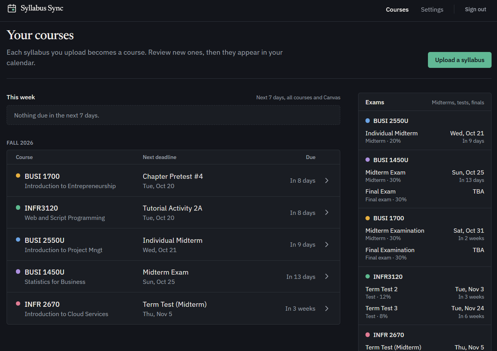

# Syllabus Sync

**Turn course syllabi into a calendar you can trust.** Upload a syllabus PDF; Claude finds every deadline,
exam and grade weight; you check them beside the original; confirmed deadlines appear in your calendar app.
Self-hosted: it runs on your own server, for you and the people you invite.



## What it does

- **Reads syllabi for you.** Upload a PDF and get every assignment, quiz, test and exam with its date and weight,
  including "Week 5" style dates worked out from the first day of classes.
- **You stay in control.** Nothing is saved until you've checked it next to the PDF, with the exact quote each row
  came from, and warnings for anything unsure: weights that don't add up, missing dates, dates outside the term.
- **A calendar feed** for Apple, Google or Outlook Calendar. Edits update events instead of duplicating them.
- **One place for the term:** "This week" across all your courses, an Exams panel, a "Next up" card on each
  course, course colours, and ticking work off as done.
- **"What do I need on the final?"** A grade calculator using your syllabus weights.
- **Canvas, if your school uses it:** your current grade, what's due and whether you've handed it in, what's missing
  and what's been graded, all next to your syllabus deadlines. [More below](#canvas).





## Canvas

Many schools run their courses on [Canvas](https://www.instructure.com/canvas). If yours does, link it once in
**Settings → Canvas** and Syllabus Sync brings Canvas's live information next to your syllabus deadlines:

- **On each course page:** your current grade, what's due in the next two weeks with **Submitted** or **Not
  submitted** beside each item, anything Canvas has marked **Missing**, and your recently graded work with the
  score and percentage. Every item links straight to it in Canvas.
- **In "This week":** deadlines from your syllabus show whether Canvas has them as submitted, graded or missing,
  and work that's only in Canvas (a quiz your instructor added later, a reflection, a lockdown-browser test) appears
  alongside them, marked "Canvas".
- **In the grade calculator:** "Use Canvas marks" fills in every mark Canvas already has, so "what do I need on the
  final?" uses your real scores. They're only saved if you choose to save them.

The screenshot at the top shows this: the "Canvas" items in "This week" come straight from Canvas.



**Linking it:** in Canvas, go to **Account → Settings → New access token**, name it "Syllabus Sync", set it to expire
at the end of term, and paste it into Settings along with your school's Canvas address. Syllabus Sync checks the
token with Canvas, then matches each of your courses to its Canvas course by course code (you confirm the match
once).

**How it's handled:**

- **Read-only.** Syllabus Sync only ever reads from Canvas; it never submits, changes or deletes anything.
- **Encrypted.** The token is encrypted (AES-256-GCM) with a key that only your server has, decrypted only on the
  server for your own requests, and never sent back to the browser or written to the logs.
- **Live, not copied.** Grades and assignments are fetched from Canvas when you open a page and aren't stored.
- **Yours to revoke.** Unlink Canvas in Settings any time, and delete the token in Canvas to cut access completely.

Canvas works with any school's Canvas, as long as the school lets students create access tokens: look for the
**New access token** button under Account → Settings. Check your school's IT rules too.

## Quick start

Requirements: a Linux machine or VM (amd64 or arm64) with 3 GB of RAM (4 GB recommended), Docker Engine with the
Compose plugin, and an [Anthropic API key](https://console.anthropic.com) for reading syllabi (a syllabus costs
roughly $0.05–0.30 to read).

```bash
git clone https://github.com/Dev-APkash/syllabus-sync.git
cd syllabus-sync/selfhost
bash setup.sh              # asks for your address and API key, generates every secret
docker compose pull
docker compose up -d
```

`setup.sh` sets `APP_IMAGE` to the published image (`ghcr.io/dev-apkash/syllabus-sync`), so nothing is built on your
machine; leave it empty and run `docker compose up -d --build` to build from source instead.

Then make it reachable over HTTPS (Tailscale Serve, your own domain behind a reverse proxy, or a quick test on
your local network): see **[docs/install.md](docs/install.md)**. Open the address, create your account, and
upload a syllabus.

## Documentation

| Guide                                        | What's in it                                                      |
| -------------------------------------------- | ----------------------------------------------------------------- |
| [Install](docs/install.md)                   | Requirements, the three ways to reach it, first account           |
| [Configuration](docs/configuration.md)       | Every setting in `.env`                                           |
| [Backups](docs/backups.md)                   | `backup.sh`, `restore.sh`, nightly backups                        |
| [Upgrading](docs/upgrading.md)               | Moving to a new version, and rolling back                         |
| [Security](docs/security.md)                 | What's exposed, where your data and secrets live                  |
| [FAQ](docs/faq.md)                           | Costs, Google Calendar, forgotten passwords, Canvas, uninstalling |
| [Self-hosting reference](selfhost/README.md) | Everyday commands, Studio, troubleshooting                        |

## How it's built

```text
Your devices ── HTTPS ──► Caddy (the only open port)
                            ├── /auth/v1, /rest/v1, /storage/v1 ──► Supabase: Auth, PostgREST, Storage ──► Postgres
                            └── everything else ──► Syllabus Sync (Next.js) ──► Claude API (reads PDFs)
                                                                            └─► Canvas API (optional, read-only)
Calendar apps ──► /api/calendar/<secret>.ics
```

- **Row Level Security** in Postgres: each student only ever sees their own courses, deadlines, files and Canvas
  link, even through the public APIs.
- **Structured outputs + Zod:** Claude answers in a strict JSON schema, which is validated again on the server.
  AI results are always drafts until the student confirms them.
- **Cost guards:** one attempt per reading, 3 readings per syllabus, a daily limit per student and a kill switch,
  all enforced in the database.
- **One image for every install:** the address and keys are read when the container starts.
- **Tested end to end on every change:** unit tests, a smoke test of the whole stack, a real-browser test, backup →
  restore (including onto an empty machine) and password reset.

Built with Next.js, React, TypeScript, Tailwind CSS, shadcn/ui, Supabase, the Claude API, `ics`, `date-fns-tz`,
Vitest and Playwright.

## Contributing and support

Bug reports and ideas are welcome as GitHub issues. For a security problem, please don't open a public issue:
see [SECURITY.md](SECURITY.md).

## Licence

Syllabus Sync is free software under the [GNU Affero General Public License v3.0 or later](LICENSE): you can use,
change and share it, and if you run a modified version for other people over a network, you must offer them its
source code. The Supabase configuration files in `selfhost/supabase/` come from
[Supabase](https://github.com/supabase/supabase) under the Apache License 2.0 (see the README in that folder); the
fonts in `app/fonts/` are under the SIL Open Font License.
